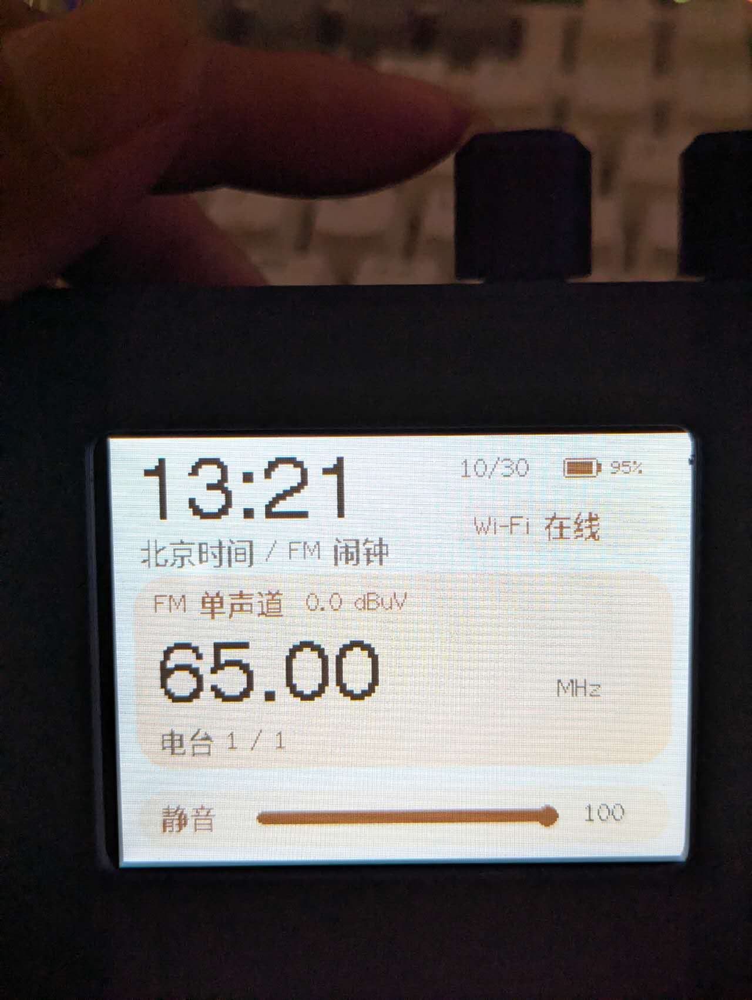
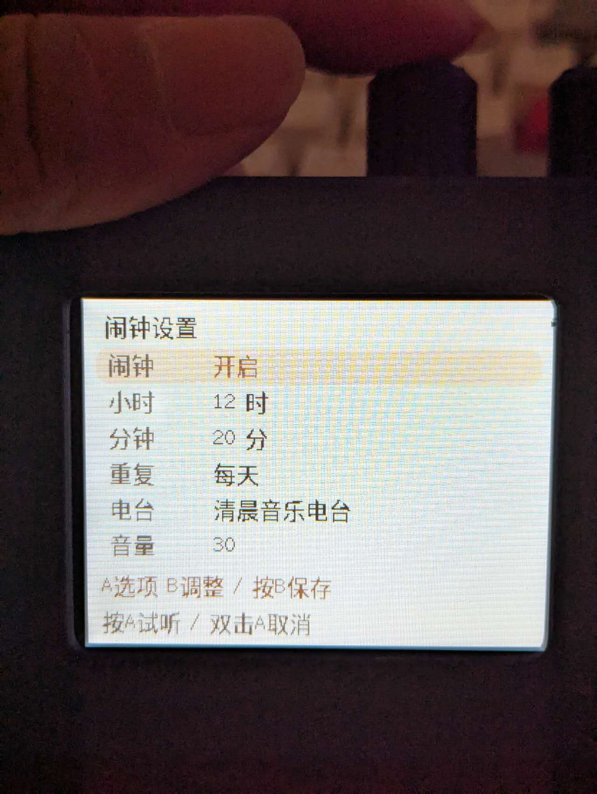
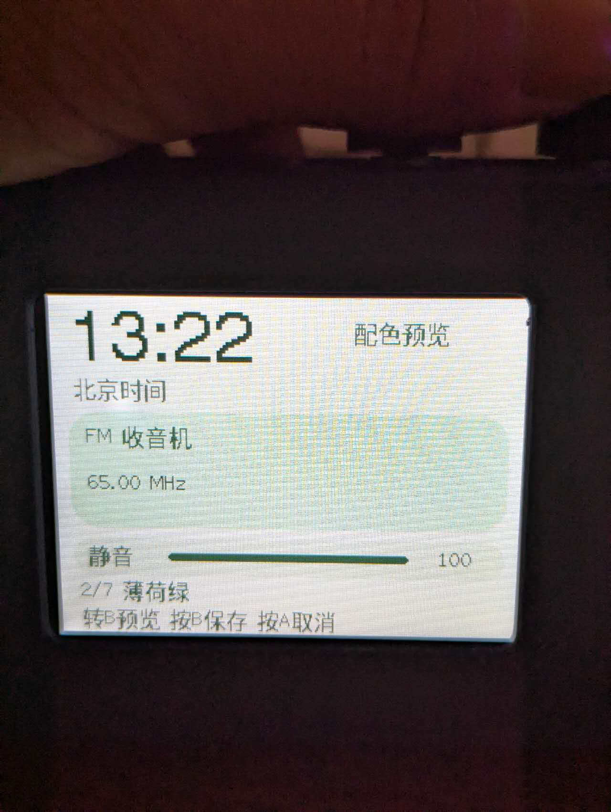
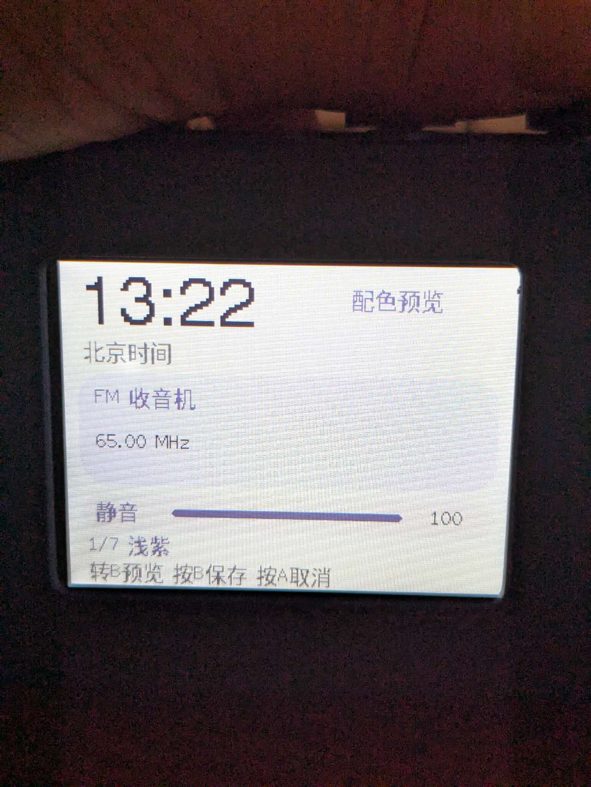
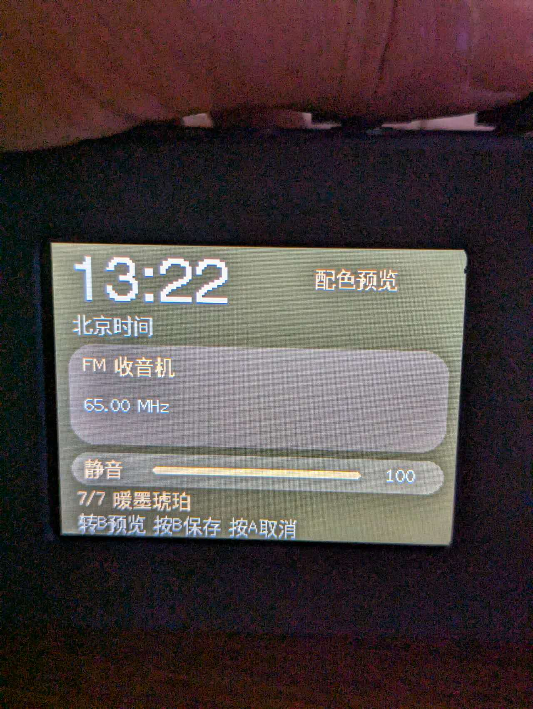
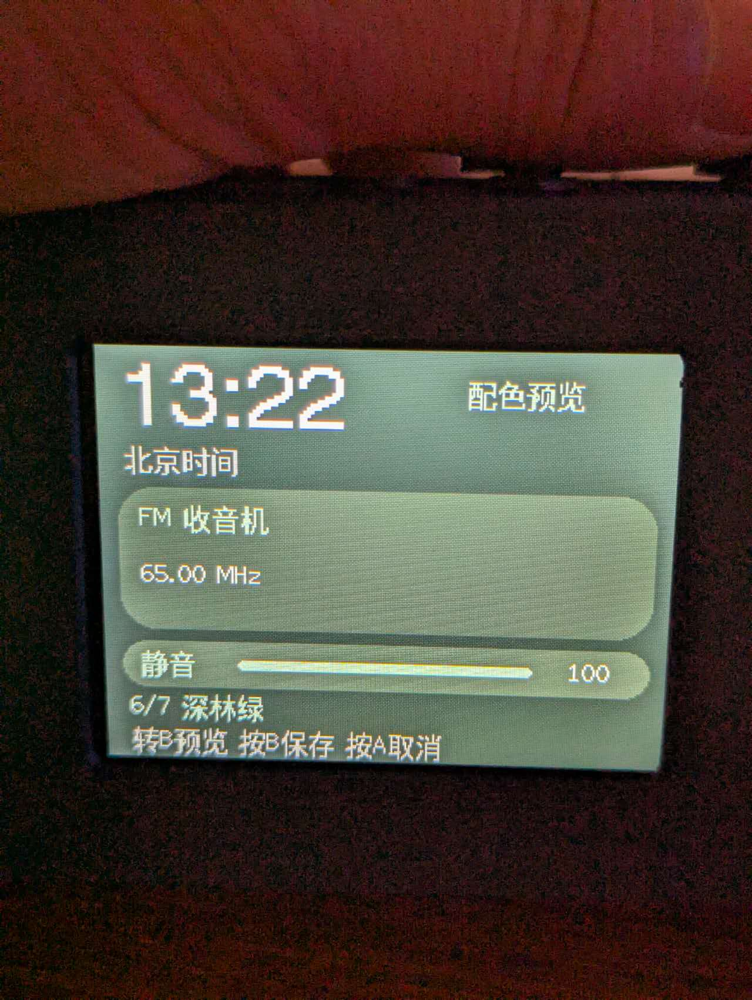
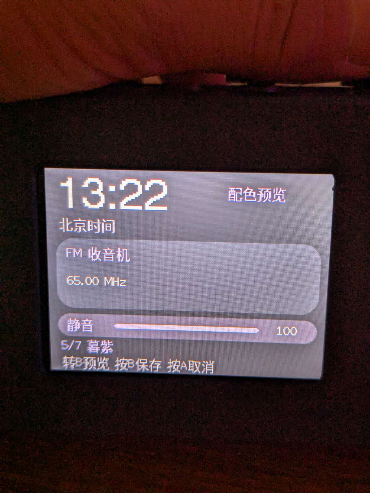

# O-Radio — STS-6686N3

ESP32-S3 + TEF6686 网络/FM 收音机

- **当前项目和构建入口：[`merchant_s3/`](merchant_s3/README.md)**
- 硬件引脚：[`board_sts_6686n3.h`](merchant_s3/include/board_sts_6686n3.h)
- 构建、操作和测试：[`项目说明`](merchant_s3/README.md)
- 公开前检查：[`PUBLICATION_CHECK.md`](docs/PUBLICATION_CHECK.md)

本地保留的固件产物、原厂镜像、恢复资料、研究笔记和清理清单不随源码提交；下载固件可另行发布到 GitHub Releases。

本仓库只包含当前 STS-6686N3 工程，不携带上游完整 Git 历史或本机恢复资料。原 PE5PVB 项目来源保留在归属说明中。
保留 GPL-3.0 许可及第三方归属，见 [LICENSE](LICENSE) 和 [归属说明](docs/ATTRIBUTION.md)。

原厂备份包含设备配置，属于私人恢复资料，不随源码分享。
      
